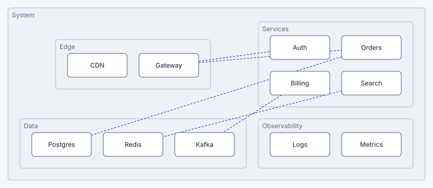

# ireko

**Composable graph and tree layout for TypeScript. Select a layout for each container, and get boxes and routed edges for any renderer.**

ireko (入れ子) is the Japanese word for a set of boxes that fit inside each other. The project had the name Jqy before.

**The guide, the gallery and the playground:** [mark1russell7.github.io/ireko](https://mark1russell7.github.io/ireko/)



## Status

The project is in a rebuild. The plan is in [`docs/REVIEW.md`](./docs/REVIEW.md).

| Phase | Content | Status |
|---|---|---|
| P0 | The template monorepo, pnpm, TypeScript 7, Oxlint, `ste-lint`, CI | done |
| P1 | The new core: two passes, an open strategy registry, plain JSON output, SVG export | done |
| P2 | The builder, the text language, and the SVG, DOM, Canvas, React and React Flow renderers | done |
| P3 | More strategies, sizing policies and routers | in progress: `tree`, `layers` and the router `avoid` are done |
| P4 | The site: the guide, the gallery, the playground and live figures | done |
| P5 | The first release on npm | ready: the owner publishes 0.1.0 |

The code of Jqy is in the git history. The site compares its output with the output of ireko.

## The idea

A diagram is a tree of nodes. Each node selects two things for its children:

- **The strategy:** how to arrange the children. The built-in strategies are `grid`, `radial`, `tree` (a tidy tree) and `layers` (a flowchart).
- **The mode:** where the children go. In the `nested` mode, the children are inside the box of the node. In the `linked` mode, the children are around the box, and edges connect them.

One layout gives plain data: boxes, edges and findings. Any renderer can draw it.

## Use it

The library is not on npm yet. The package `ireko` is ready for its first version. In this repository:

```ts
import { layout } from "ireko";
import { toSVG } from "ireko/svg";

const result = layout({
  root: {
    id: "system",
    mode: "nested",
    children: [
      { id: "web", layout: "radial", mode: "nested", children: [{ id: "home" }, { id: "cart" }, { id: "search" }] },
      { id: "api", children: [{ id: "auth" }, { id: "orders" }] },
    ],
  },
});

result.nodes; // the boxes: { id, x, y, width, height, container, ... }
result.edges; // the edges, with their points
result.issues; // the findings: overlaps, bad options, limits
const svg = toSVG(result);
```

The builder gives the same data with less text:

```ts
import { grid, radial } from "ireko";

const root = grid.nested("system", radial.nested("web", "home", "cart", "search"), grid("api", "auth", "orders"));
```

The text language gives it again, for the playground and for quick sketches:

```ts
import { parse } from "ireko/text";

const result = parse(`
system nested {
  web radial nested { home cart search }
  api { auth orders }
}
web -> api "calls"
`);
```

| Subpath | Contents |
|---|---|
| `ireko` | The engine, the strategies, the routers, the audit and the builder |
| `ireko/text` | `parse` and `print` for the text language |
| `ireko/svg` | `toSVG` (a string) and `mountSvg` (a live renderer) |
| `ireko/dom` | `mountDom`: a live renderer with elements |
| `ireko/canvas` | `mountCanvas`: a live renderer on a canvas |
| `ireko/render` | The viewport, the themes and the animations that the live renderers share |
| `ireko/react` | `useLayout`, `LayoutSvg` and `LayoutView` |
| `ireko/xyflow` | `toXYFlow`, `PolylineEdge` and `layoutFlow` for React Flow 12 |
| `ireko/examples` | The examples of the gallery |

## Packages

| Package | Contents |
|---|---|
| [`ireko`](./packages/ireko) | The library: the engine, the builder, the text language, the renderers and the adapters |
| [`@ireko/site`](./packages/site) | The site: Astro and Starlight, with the playground, the gallery and the guide |
| [`@ireko/cli`](./packages/cli) | The workspace commands of the template |

## Commands

```sh
pnpm install
pnpm dev             # the site, with the playground, at http://localhost:4321/ireko/
pnpm typecheck       # the source and the tests of each package
pnpm lint            # Oxlint, with the type-aware rules
pnpm test            # the tests of each package
pnpm test:coverage   # the tests of ireko, with the coverage gates
pnpm lint:ste        # the writing rules
pnpm check           # all of the above, in the order of CI
pnpm package add <name> --preset=<node|node-cjs|ts|vite|react>
```

## Writing style

The text of this repository uses the writing rules of ASD-STE100 Simplified Technical English (STE) as a style target. This text is the README files, the docs, the TSDoc comments and the text that the site shows. ASD does not certify the repository. The linter [`ste-lint`](https://github.com/mark1russell7/ste-lint) is an automated approximation of the rules, and CI starts it for each push.

- Use `pnpm lint:ste` to examine the text, and correct each finding.
- The glossary of the project is in `ste.config.json`. Add a word to the glossary only if it is a real technical term of the project.
- The ASD-STE100 dictionary is copyrighted. Do not commit it. Keep a local copy in the folder `.ste/`, which git ignores. The README of `ste-lint` gives the file format.

## Disclosure

An AI model (Claude, from Anthropic) wrote most of the text and the code of this repository, under the direction of the author. The STE linter examines the text. The STEMG of ASD-STE100 asks for this disclosure in its white paper on STE and artificial intelligence (June 2026).

## License

[MIT](./LICENSE)
